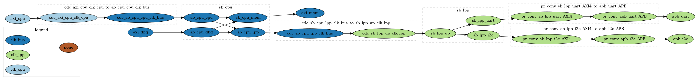
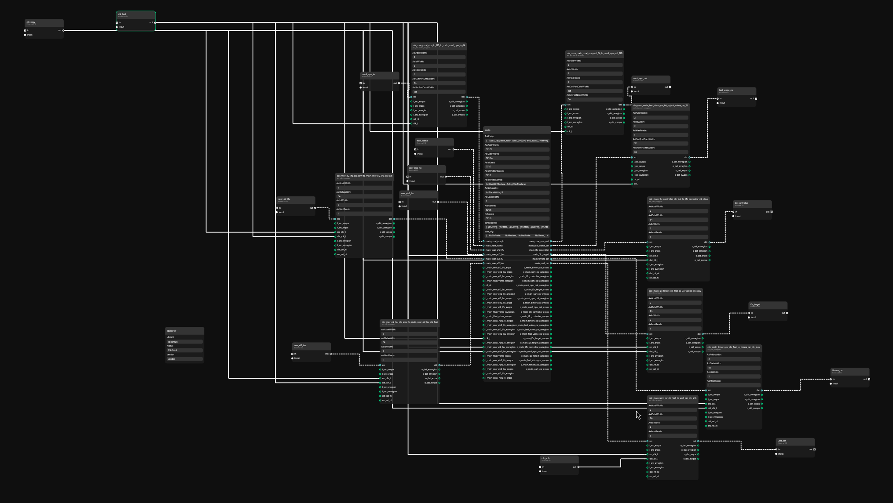

Copyright Antmicro 2026

# Omnibus

Omnibus can be used to generate desired interconnect from supplied specification.
Currently it is used as a supplementary to Topwrap - it generates necessary wrappers and creates Topwrap project file. 
In the future Omnibus will be able to support variety of backends, including direct verilog generation.


## Installation
Install with [uv](https://docs.astral.sh/uv/), as a command line tool:
```sh
git clone --recursive https://github.com/antmicro/omnibus
uv tool install ./omnibus/
```
or into a virtual environment:
```sh
git clone --recursive https://github.com/antmicro/omnibus
uv venv
uv pip install ./omnibus/
```

## Usage
### Input format
Input format specification can be find in: https://antmicro.github.io/omnibus/specification.html
### CLI
You can see the exact usage with
```sh
omnibus --help
```
But the simplest command that generates topwrap specification is
```sh
omnibus FILENAME.yml
```
### Python package
Omnibus can also be used as python package, but as the interface is very likely to change, it is not yet described here.
You can find the current usage in the methods of `omnibus/interconnect.py` or in the wrapper in `omnibus/main.py` 

## Examples
### Clock domains 
With 
```sh
omnibus tests/spec_example.yml --graph --colorby clock
```
You can generate the interconnect graph from example given in specification and color ports (represented by nodes) depending on the clock domain they belong to.




### Topwrap generation
Generating a full Topwrap project takes a few more steps. You can generate one from the ASoCa specification with:
```sh
omnibus tests/asoca2.yml 
topwrap repo init repo out/modules/
topwrap repo parse repo out/src/ 
```
You'll then find the interconnect in `out/interconnect.yml`. You can view it with `topwrap gui` or generate Verilog from it with `topwrap build`
see Topwrap documentation for more details on topwrap usage: https://antmicro.github.io/topwrap/getting_started.html



Note: the verilog files generated are not yet fully correct, topwrap throws many warnings and the final result is not yet usable

## Internal operation
Internally, Omnibus is organized as single python class `Interconnect` with simple wrapper in `main.py`.  

This class is then used to:
1. Read yaml specification
2. Construct graph representation 
3. Finding all routing paths from interconnect managers to subordinates 
4. Propagating parameters (clock, data width, protocol)
5. Inserting necessary parameter converters 
6. Mapping abstract components to actual implementation
7. Generating necessary IP Cores 
8. Generating final output 

Steps can be logically grouped as:
- Fronted: 1
- Internal: 2 to 5
- Backend: 6 to 8

### Fronted
Fronted is generally fixed, but in theory it could be replaced with python API.
It reads file specified in yaml and dictionary with ports, components, address maps, and all the rest that is needed.

### Internal 
Given list of requirements, the graph is generated to allow for further processing.

#### Routing paths
The specification sets single address map for the entire interconnect, this has to be converted into separate address map for each component.   
Omnibus runs pathfinding algorithm from all source ports into destination ports, saving how each crossbar is to be configured for that path.  

Then for each source->destination path in address map, the rule is properly adjusted for each crossbar.

Currently, due to limitations of pulp-platform backend, rules must be the same for all sources.   

### Parameter Propagation
For this purpose, the graph is treated as undirected.  
Each port copies its parameter to all neighboring ports with no parameter, if such port is part of crossbar then it is also copied to all crossbar ports.  
This is currently too greedy and will be eventually improved to pick best parameter according to some metric.  

Parameter propagation is blocked by barriers that can be specified, for example `cdc: True` blocks clock propagation.  

If by the end there is any port with not assigned parameter then an error is thrown.

### Component Insertion
Once all components have been propagated, on any connection that has conflicting parameters a converter is inserted.  
Such converters are inserted in the order: data width, clock, protocol, due to some heuristics and pulp-platform limitations.  

Converters are iplemented from source to destination, meaning that all parameters (other than the one being converted and role) are copied from source port to the entire converter.
Role of the ports of converter is conditionally inverted based on neighboring ports to ensure that roles of the same type are not connected together.


### Backend
Currently backend is fixed to generate only components from pulp-platform and to output topwrap project.
It is still mostly work in progress therefore it is not described in detail for now.


## Planned expansion
1. Different backends
2. Throughput analysis 
3. More elaborate metrics 
