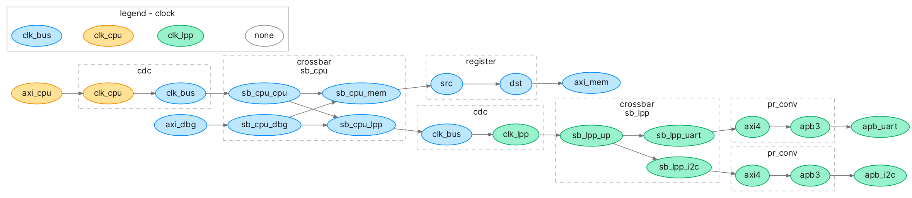

Copyright Antmicro 2026

# Omnibus

Omnibus can be used to generate desired interconnect from supplied specification.
Currently it is used as a supplementary to Topwrap - it generates necessary wrappers and creates Topwrap project file. 
In the future Omnibus will be able to support variety of backends, including direct verilog generation.

Documentation: https://antmicro.github.io/omnibus/

## Installation
Install with [uv](https://docs.astral.sh/uv/), as a command line tool:
```sh
git clone --recursive https://github.com/antmicro/omnibus
uv tool install ./omnibus/
```
or into a virtual environment:
```sh
git clone --recursive https://github.com/antmicro/omnibus
uv venv
uv pip install ./omnibus/
```

## Usage
### Input format
Input format specification can be find in: https://antmicro.github.io/omnibus/specification.html
### CLI
You can see the exact usage with
```sh
omnibus --help
```
But the simplest command that generates topwrap specification is
```sh
omnibus FILENAME.yml
```
### Python package
Omnibus can also be used as python package, but as the interface is very likely to change, it is not yet described here.
You can find the current usage in the methods of `omnibus/interconnect.py` or in the wrapper in `omnibus/main.py` 

## Examples
### Clock domains 
With 
```sh
omnibus examples/spec.yml --graph --colorby clock
```
You can generate the interconnect graph from example given in specification and color ports (represented by nodes) depending on the clock domain they belong to.




### Topwrap generation
Generating a full Topwrap project takes a few more steps. You can generate one from the ASoCa specification with:
```sh
omnibus tests/asoca2.yml 
topwrap repo init repo out/modules/
topwrap repo parse repo out/src/ 
```
You'll then find the interconnect in `out/ASoCaInt.yml`. You can view it with `topwrap gui` or generate Verilog from it with `topwrap build`
see Topwrap documentation for more details on topwrap usage: https://antmicro.github.io/topwrap/getting_started.html


