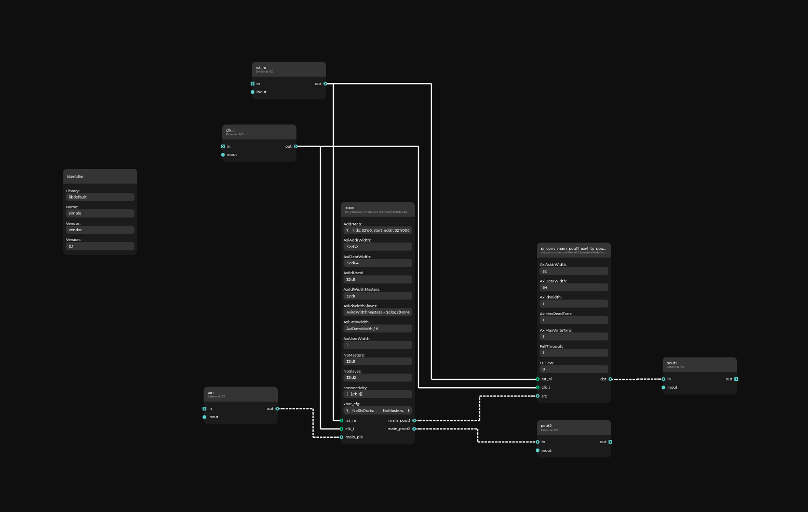

# Omnibus

Copyright (c) 2026 [Antmicro](https://antmicro.com)

Omnibus can be used to generate a desired interconnect from a supplied specification.
It generates all necessary wrappers and creates a Topwrap project file and calls [Topwrap](https://github.com/antmicro/topwrap) to generate the SystemVerilog code.

For more information, refer to the [official documentation](https://antmicro.github.io/omnibus/).

## Installation
Install with [uv](https://docs.astral.sh/uv/) as a command line tool:
```sh
git clone --recursive https://github.com/antmicro/omnibus
uv tool install ./omnibus/
```
or create a virtual environment:
```sh
git clone --recursive https://github.com/antmicro/omnibus
uv venv
uv pip install ./omnibus/
```

## Usage
### Input format
The input format specification can be found in: https://antmicro.github.io/omnibus/specification.html
### CLI
For exact usage directions, use the `--help` command:
```sh
omnibus --help
```
To easily generate a Topwrap specification:
```sh
omnibus FILENAME.yml
```
### Python package
Omnibus can also be used as Python package, but as the interface is very likely to change, it is a feature that is undescribed for now.
You can find the current implementation in `omnibus/interconnect.py`, or in the wrapper in `omnibus/main.py`.

## Examples
### Clock domains 
With:
```sh
omnibus examples/spec.yml --graph --colorby clock
```
You can generate an interconnect graph from an example given in the specification and with color ports (represented by nodes) depending on the clock domain they belong to.


### Topwrap generation
With `--verilog`, Omnibus also runs Topwrap to generate the Verilog top level.
You can generate one from the `examples/simple.yml` specification with:
```sh
omnibus examples/simple.yml --verilog
```
You'll then find the interconnect in `out/simple.yml` and the Verilog top level in `build/src/simple.sv` (use `-b` to choose a different build directory).
You can view the interconnect with `topwrap gui`.
See Topwrap's [documentation](https://antmicro.github.io/topwrap/getting_started.html) for more details on Topwrap usage.


