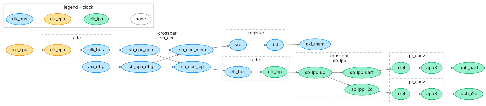
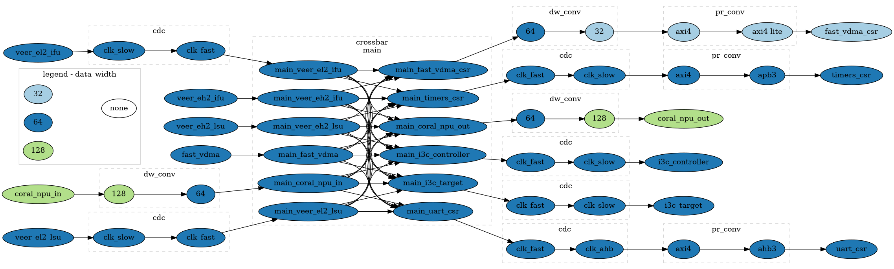
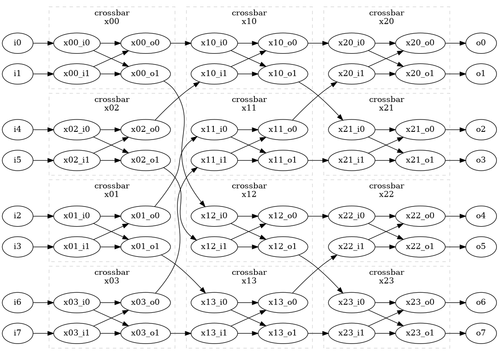

# Examples 
## Two crossbars with memory and APB devices

This example demonstrates usage of Omnibus to generate interconnect with two crossbars. 
End ports are assigned to two different interfaces, and three different clocks. 
Omnibus automatically generates appropriate clock domain crossings and protocol conversions.  



### Specification
```yaml
desc_version: 1.0

name: MyInterconnect
version: 0.85a

default:
    data_width: 32
    protocol: AXI4
    clock: clk_bus

clocks:
  clk_bus:
    frequency: 100e6
  clk_cpu:
    frequency: 1GHz
  clk_lpp:
    frequency: 25M

ports:
  axi_cpu:
    clock: clk_cpu
    role:  "subordinate"
  axi_dbg:
    role:  "subordinate"
  axi_mem:
    role:  "manager"
  apb_uart:
    protocol:  APB
    clock: clk_lpp
    role:  "manager"
  apb_i2c:
    protocol:  APB
    clock: clk_lpp
    role:  "manager"

crossbars:
  sb_cpu:
    ports:
      cpu:
        role: "subordinate"
      dbg:
        role: "subordinate"
      mem:
        role: "manager"
      lpp:
        role: "manager"
  sb_lpp:
    clock: clk_lpp
    ports:
      up:
        role: "subordinate"
      uart:
        role: "manager"
      i2c:
        role: "manager"

connections:
  "axi_cpu -> sb_cpu.cpu":
  "axi_dbg -> sb_cpu.dbg":
  "sb_cpu.mem -> axi_mem":
    "registers": 1 # Insert a skid buffer to help timing closure
  "sb_cpu.lpp -> sb_lpp.up":
  "sb_lpp.uart -> apb_uart":
  "sb_lpp.i2c -> apb_i2c":

address_map:
  "memory": # All ports can access axi_mem
    to:    axi_mem
    base:  0x00000000
    size:  0x20000000
  "uart":  # Only CPU can access UART
    from:  axi_cpu
    to:    apb_uart
    base:  0x40000000
    size:  0x00001000
  "i2c":   # Explicitly axi_cpu and axi_dbg can access apb_i2c
    from:  ["axi_cpu", "axi_dbg"]
    to:    apb_i2c
    base:  0x40001000
    size:  0x00001000
```

### Command
`omnibus examples/spec.yml -g --colorby clock`

## ASoCa

This example demonstrates usage of Omnibus to generate ASoCa's interconnect.
It does not have explicit crossbar specified but instead automatically generates an all-to-all one.



### Specification
```yaml
desc_version: 1.0

name: ASoCaInt
version: 0

default:
  clock:
    clk_fast
  protocol:
    axi4
  data_width: 64

clocks:
  clk_slow:
    frequency: 300MHz
  clk_fast:
    frequency: 800MHz
  clk_ahb:
    frequency: 100MHz

ports:
  veer_el2_ifu:
    role: "subordinate"
    clock: clk_slow
  veer_el2_lsu:
    role: "subordinate"
    clock: clk_slow
  veer_eh2_ifu:
    role: "subordinate"
  veer_eh2_lsu:
    role: "subordinate"
  fast_vdma:
    role: "subordinate"
  fast_vdma_csr:
    protocol: axi4 lite
    role: "manager"
    data_width: 32
  timers_csr:
    protocol: apb3
    role: "manager"
    clock: clk_slow
  coral_npu_out:
    role: "manager"
    data_width: 128
  coral_npu_in:
    role: "subordinate"
    data_width: 128
  i3c_controller:
    role: "manager"
    clock: clk_slow
  i3c_target:
    role: "manager"
    clock: clk_slow
  uart_csr:
    protocol: ahb3
    role: "manager"
    data_width: 64
    clock: clk_ahb

address_map:
  "i3c_target_csr":
    to: i3c_target
    base: 0x4000_0000
    size: 0x0000_FFFF
  "i3c_controller_csr":
    to: i3c_controller
    base: 0x4001_0000
    size: 0x0000_FFFF
  "uart_csr":
    to: uart_csr
    base: 0x4002_0000
    size: 0x0000_FFFF
  "timers_csr":
    to: timers_csr
    base: 0x4003_0000
    size: 0x0000_FFFF
  "fastvdma_csr":
    to: fast_vdma_csr
    base: 0x5000_0000
    size: 0x0000_FFFF
  "coral_npu_out":
    to: coral_npu_out
    base: 0x6000_0000
    size: 0x0FFF_FFFF
```

### Command
`omnibus examples/asoca_implicit_crossbar.yml -g --colorby data_width`


## Butterfly

This example demonstrates more complex network of crossbars - butterfly configuration.



### Specification
```yaml
desc_version: 1.0

name: butterfly

default:
  protocol: AXI4
  clock: clk
  data_width: 32

ports:
  i0:
    role:  "subordinate"
  i1:
    role:  "subordinate"
  i2:
    role:  "subordinate"
  i3:
    role:  "subordinate"
  i4:
    role:  "subordinate"
  i5:
    role:  "subordinate"
  i6:
    role:  "subordinate"
  i7:
    role:  "subordinate"
  o0:
    role:  "manager"
  o1:
    role:  "manager"
  o2:
    role:  "manager"
  o3:
    role:  "manager"
  o4:
    role:  "manager"
  o5:
    role:  "manager"
  o6:
    role:  "manager"
  o7:
    role:  "manager"

crossbars:
  x00:
    ports:
      i0:
        role: "subordinate"
      i1:
        role: "subordinate"
      o0:
        role: "manager"
      o1:
        role: "manager"
  x01:
    ports:
      i0:
        role: "subordinate"
      i1:
        role: "subordinate"
      o0:
        role: "manager"
      o1:
        role: "manager"
  x02:
    ports:
      i0:
        role: "subordinate"
      i1:
        role: "subordinate"
      o0:
        role: "manager"
      o1:
        role: "manager"
  x03:
    ports:
      i0:
        role: "subordinate"
      i1:
        role: "subordinate"
      o0:
        role: "manager"
      o1:
        role: "manager"
  x10:
    ports:
      i0:
        role: "subordinate"
      i1:
        role: "subordinate"
      o0:
        role: "manager"
      o1:
        role: "manager"
  x11:
    ports:
      i0:
        role: "subordinate"
      i1:
        role: "subordinate"
      o0:
        role: "manager"
      o1:
        role: "manager"
  x12:
    ports:
      i0:
        role: "subordinate"
      i1:
        role: "subordinate"
      o0:
        role: "manager"
      o1:
        role: "manager"
  x13:
    ports:
      i0:
        role: "subordinate"
      i1:
        role: "subordinate"
      o0:
        role: "manager"
      o1:
        role: "manager"
  x20:
    ports:
      i0:
        role: "subordinate"
      i1:
        role: "subordinate"
      o0:
        role: "manager"
      o1:
        role: "manager"
  x21:
    ports:
      i0:
        role: "subordinate"
      i1:
        role: "subordinate"
      o0:
        role: "manager"
      o1:
        role: "manager"
  x22:
    ports:
      i0:
        role: "subordinate"
      i1:
        role: "subordinate"
      o0:
        role: "manager"
      o1:
        role: "manager"
  x23:
    ports:
      i0:
        role: "subordinate"
      i1:
        role: "subordinate"
      o0:
        role: "manager"
      o1:
        role: "manager"

connections:
#port -> interconnect
  "i0 -> x00.i0":
  "i1 -> x00.i1":
  "i2 -> x01.i0":
  "i3 -> x01.i1":
  "i4 -> x02.i0":
  "i5 -> x02.i1":
  "i6 -> x03.i0":
  "i7 -> x03.i1":

#1st stage
  "x00.o0 -> x10.i0":
  "x00.o1 -> x12.i0":
  "x01.o0 -> x11.i0":
  "x01.o1 -> x13.i0":
  "x02.o0 -> x10.i1":
  "x02.o1 -> x12.i1":
  "x03.o0 -> x11.i1":
  "x03.o1 -> x13.i1":

#2nd stage
  "x10.o0 -> x20.i0":
  "x10.o1 -> x21.i0":
  "x11.o0 -> x20.i1":
  "x11.o1 -> x21.i1":
  "x12.o0 -> x22.i0":
  "x12.o1 -> x23.i0":
  "x13.o0 -> x22.i1":
  "x13.o1 -> x23.i1":

#interconnect -> port
  "x20.o0 -> o0":
  "x20.o1 -> o1":
  "x21.o0 -> o2":
  "x21.o1 -> o3":
  "x22.o0 -> o4":
  "x22.o1 -> o5":
  "x23.o0 -> o6":
  "x23.o1 -> o7":

address_map:
  "o0":
    to:    o0
    base:  0x00000000
    size:  0x10000000
  "o1":
    to:    o1
    base:  0x10000000
    size:  0x10000000
  "o2":
    to:    o2
    base:  0x20000000
    size:  0x10000000
  "o3":
    to:    o3
    base:  0x30000000
    size:  0x10000000
```

### Command
`omnibus examples/butterfly.yml -g`

