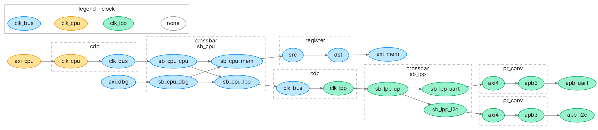

# Overview 
## Introduction

Omnibus lets you generate interconnect from specification.
It populates the interconnect with all necessary components like CDC or protocol converters.
Currently it is used as supplementary to Topwrap - it generates all wrappers and creates Topwrap project file.
You can view the generated interconnect with [Graphviz](https://graphviz.org/).
In the future Omnibus will support variety of backends, including direct verilog generation.

## Simple Example

Below is a simple example, an interconnect with 5 ports:
- CPU
- debug
- memory
- uart
- i2c  

and two crossbars:  
- cpu/debug to memory/io
- io 

Omnibus automatically inserts clock and protocol converters between ports.
The output is colored according to clock domain of each port.

For more examples and see [Examples](./examples.md).  

