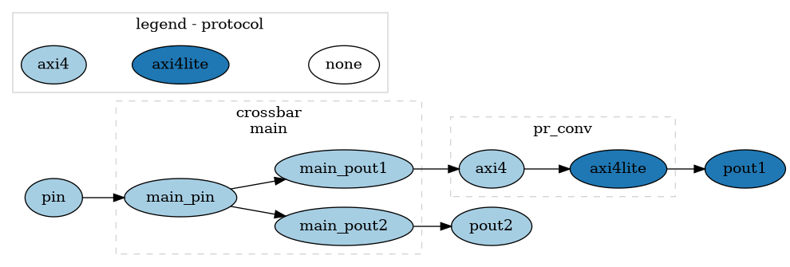

# User Guide

Before running any commands, check [installation](./installation.md).  

## Specification

You describe the interconnect to generate in a `yaml` file, according to the [specification](./specification.md).
There are no requirements on the file location or name.

A very simple specification of interconnect: 
```yaml
desc_version: 1.0

name: simple
version: 1.0

default:
  data_width: 64
  clock: clk
  frequency: 10MHz
  protocol: AXI4

ports:
  pin:
    role: "subordinate"
  pout1:
    role: "manager"
    protocol: AXI4Lite
  pout2:
    role: "manager"

address_map:
  pout1:  
    to: pout1
    base: 0x0000_0000
    size: 0x8000_0000
  pout2:  
    to: pout2
    base: 0x8000_0000
    size: 0x8000_0000
```
The file can also be found in [examples/simple.yml](https://github.com/antmicro/omnibus/blob/main/examples/simple.yml).  

Most of the fields are automatically inferred by Omnibus or are taken from the `default`, so you don't need to specify them explicitly. 
The file specifies an interconnect with one input port and two output ports, where the lower half of address leads to the first output, and the upper half to the second output.  

The ports are described from the perspective of the interconnect, so connect the manager device to the subordinate port.  

The interconnect has the data width of 64, automatically generated clock `clk` with frequency of 10MHz assigned to all ports and components.
The interconnect mostly uses AXI4 protocol, but `pout1` uses AXI4Lite, Omnibus notices that and inserts protocol converters.  

Currently, you can use Omnibus in two ways - visualization and generation.

## Visualization

By running:
```
omnibus examples/simple.yml -g --colorby protocol
```
The window opens displaying the following interconnect graph:


The colors are assigned based on the protocol assigned to each port. 
Notice that `pr_conv` (protocol converter) has two ports, each of them uses a different protocol.
This visualization is very useful for debugging problems with interconnect structure as it abstracts implementation details.  

## Generation

Omnibus generates the final interconnect with [Topwrap](https://github.com/antmicro/topwrap).

Run Omnibus with `--verilog`:
```
omnibus examples/simple.yml --verilog
```
This generates the necessary files in `out/`, then runs Topwrap to parse them (`topwrap repo parse`) and generate the top level (`topwrap generate --verilog --flatten-interfaces`).

You'll find the interconnect in `build/src/`; use `-b` to choose a different build directory. 
It contains instantiation of all used components, in this case that is just crossbar. 

## Compilation with Verilator
To fully use this file, clone its dependencies (these and only these dependencies are needed, regardless of interconnect complexity).  
```
git clone https://github.com/pulp-platform/axi
git clone https://github.com/pulp-platform/common_cells
git clone https://github.com/pulp-platform/tech_cells_generic
```
And then verify the output with `verilator`:
```
verilator --lint-only -Wall \
    -Iaxi/include/ -Icommon_cells/include/ \
    out/verilator/general_config.vlt \
    out/verilator/pulp_platform_config.vlt \
    -f out/verilator/pulp_platform_filelist.vc \
    out/src/*sv build/src/*sv  \
    --top-module simple
```
